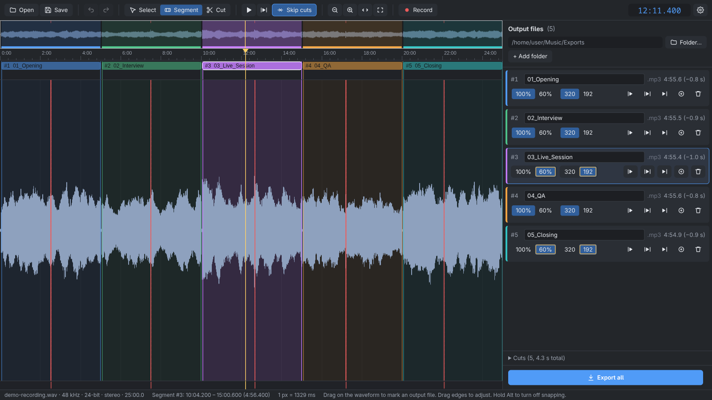
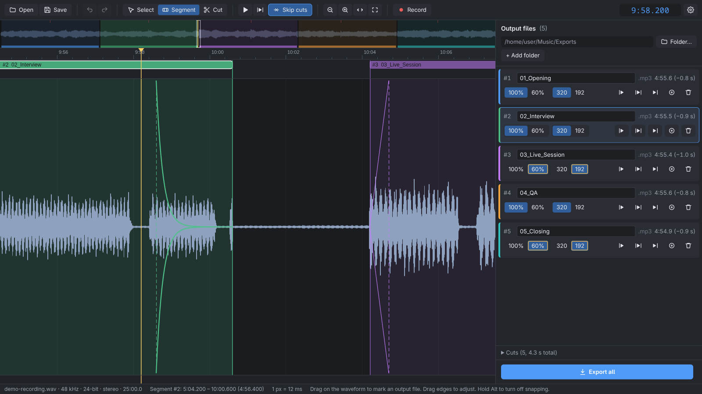
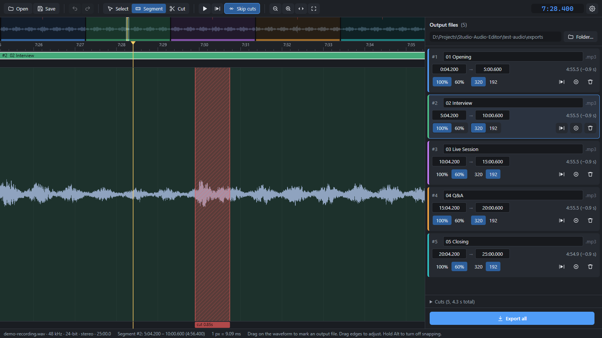
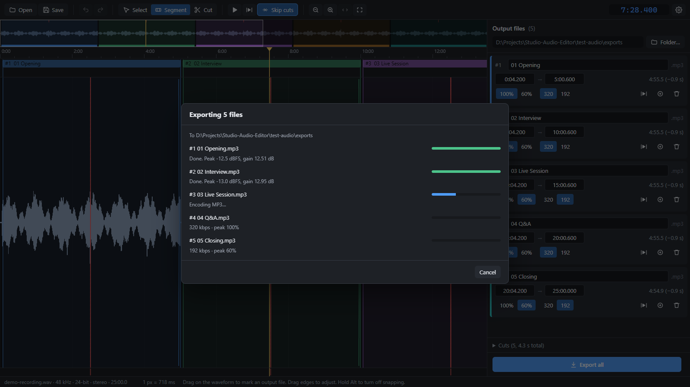
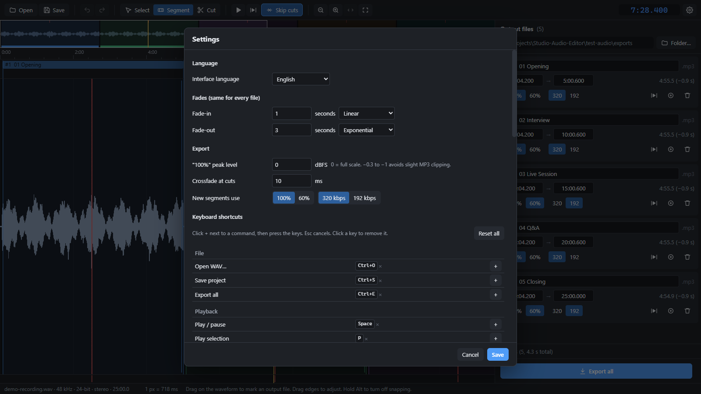
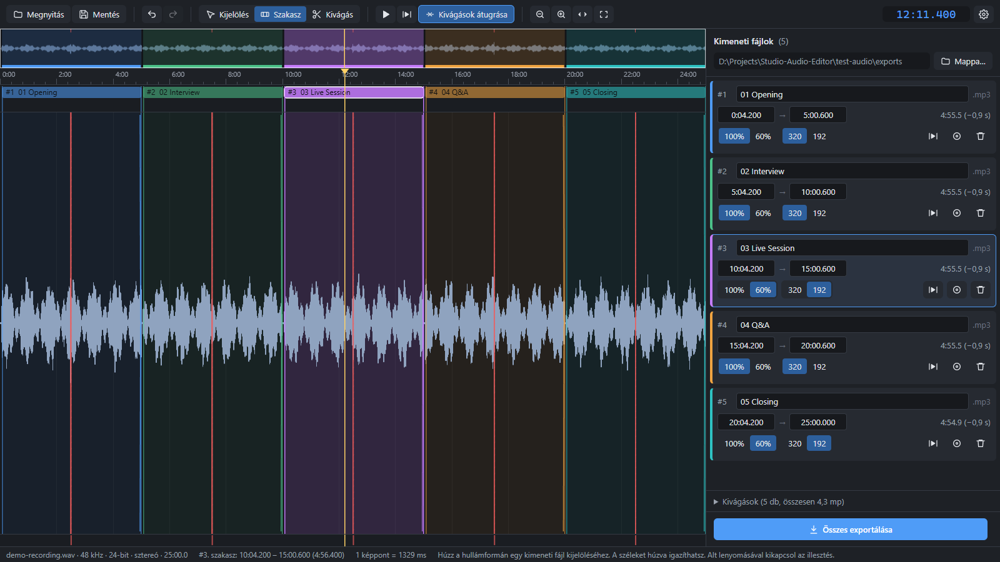

<h1> Studio Audio Editor</h1>

[](https://github.com/FeaXR/Studio-Audio-Editor/actions/workflows/build.yml)
[](LICENSE)

A focused desktop editor for cutting **one long WAV recording into several MP3 files**, for Windows and Linux.

Most audio editors work the other way round: many tracks in, one file out. Studio Audio Editor is for the opposite job: a long recording of a concert, a radio show or a lecture that has to become a set of separate, finished files. You mark where each file starts and ends, cut out coughs and noises, and export them all in one go. Each file gets consistent fades and its own loudness and bitrate.



## Features

- **One input, many outputs.** Mark any number of output files (segments) on a single WAV. Segments may slightly overlap.
- **Cuts.** Remove coughs, clicks or chatter. A cut applies to every segment it falls in, and the audio either side is joined with a short crossfade.
- **Consistent fades.** The same fade-in and fade-out on every file: linear in and exponential out by default, with other curves available.
- **Per-file peak normalization** to 100% or 60%, and **per-file bitrate** of 320 or 192 kbps (MP3, constant bitrate).
- **Built for long files.** A 90-minute 24-bit recording opens in about 3 seconds and stays smooth while zooming and scrolling. The waveform overview is cached, so reopening is instant.
- **Mouse or keyboard.** Every action works with the mouse, and every action can also have a shortcut. Mark files with I/O and cuts with X while listening, and rebind any key in Settings.
- **Hear the result.** Playback skips the cuts by default, joining them with the same crossfade as the export, and inside the selected segment it plays that file's fade-in and fade-out too. Two buttons on each file play just its start or its end, to check the fades quickly.
- **Safe export.** Filenames are checked before anything is written, you're asked before files are overwritten, and a cancelled export never leaves half-written files.
- **Sessions are saved** in one place (Documents → Studio Audio Editor), so you can come back later and re-export.
- **English and Hungarian** interface.

| Fades at a track boundary | A cut, ready to be removed |
| --- | --- |
|  |  |

| Exporting | Settings |
| --- | --- |
|  |  |

<details>
<summary>Hungarian interface</summary>



</details>

## Download

Get the latest version from the [Releases page](https://github.com/FeaXR/Studio-Audio-Editor/releases).

| System | File | Notes |
| --- | --- | --- |
| Windows | `Studio-Audio-Editor-Setup-<version>.exe` | Installer with Start menu entry and uninstaller |
| Windows | `Studio-Audio-Editor-<version>-portable.exe` | Single file, no installation. Starts a little slower because it unpacks itself each time. |
| Linux | `Studio-Audio-Editor-<version>-x86_64.AppImage` | Runs on most distributions. Make it executable first: `chmod +x Studio-Audio-Editor-*.AppImage` |
| Linux | `studio-audio-editor_<version>_amd64.deb` | For Debian, Ubuntu and derivatives |

The builds are not code-signed. On Windows, SmartScreen may show "Windows protected your PC" the first time; choose **More info → Run anyway**.

Builds of every commit are also available from the [Actions page](https://github.com/FeaXR/Studio-Audio-Editor/actions/workflows/build.yml). Open a run and download the artifact at the bottom (requires a GitHub account).

## Using it

1. **Open a WAV file.** Use the Open button or Ctrl+O, or drag the file onto the window. You can also drop it onto the program's icon or shortcut to start the app with that file.
2. **Mark the output files (segments).**
   - Mouse: drag in the **top lane** above the waveform, or drag on the waveform with the **Segment** tool (active at startup).
   - Keyboard, while listening: press **I** at the start and **O** at the end.
3. **Name each file** in the list on the right, and choose **100% / 60%** and **320 / 192** for each one.
   - **Settings → Folder rules** can set the volume and bitrate for everything written to a folder (and its subfolders). Each file follows its folder unless you pick something else for it; overridden choices are outlined, and picking the folder's value again makes the file follow the folder.
   - With a naming rule for the output folder, the start of each name is filled in for you: `{nn}` is the next free number in the folder, `{n}` the order within the recording, `{date}` comes from the WAV name (`1018_….wav` → `261018`), and `{type}` is a per-file choice such as SH / HSZ. Rules also apply to subfolders. Click the generated part to change the type, for one file, it and the ones after it, or the whole folder.
4. **Mark cuts.**
   - Mouse: drag in the **bottom lane**, or use the **Cut** tool.
   - Keyboard: press **X** where the noise starts and **X** again where it ends.
5. **Export all** with Ctrl+E. Files go to the folder shown at the top of the list, which defaults to the WAV's folder. To send some files elsewhere, use **+ Add folder**: each file then gets a folder picker, and the first folder stays the default.

Your segments and cuts are saved in `Documents/Studio Audio Editor/Sessions`, one file per WAV (Ctrl+S). The session is tied to the WAV's location, so moving or renaming the WAV starts a new one. Sessions saved next to the WAV by older versions (`<file>.wav.sae.json`) still open. They're also saved after every successful export, and they load again when you reopen the WAV.

### Mouse

| Action | How |
| --- | --- |
| Move the playhead | Click the ruler or the waveform |
| Resize a segment or cut | Drag its edge (it snaps to the playhead and other edges; hold **Alt** to stop snapping) |
| Move a segment or cut | Drag its bar in the top or bottom lane |
| Zoom | Mouse wheel over the waveform or the overview |
| Scroll | Shift + wheel, middle-drag, drag the overview, or drag the waveform with the Select tool |
| More options | Right-click a segment, a cut, or empty space |
| Rename a segment | Double-click it |

### Keyboard

These are the defaults. You can change any of them in **Settings → Keyboard shortcuts**: click **+** next to a command and press the keys you want.

| Key | Action |
| --- | --- |
| Space | Play / pause |
| P | Play the selected segment, or the audio around the selected cut |
| Shift+P / Alt+P | Play the start (fade-in) or the end (fade-out) of the segment |
| I / O | Mark a segment's start / end at the playhead |
| Shift+I / Shift+O | Move the selected segment's start / end to the playhead |
| X | Mark a cut's start, then its end |
| Alt+← / Alt+→ | Nudge the selected start by 10 ms (add Shift to nudge the end) |
| ← / → | Playhead ±1 s (add Shift for ±10 s) |
| Ctrl+← / Ctrl+→ | Playhead to the previous / next segment or cut edge |
| Home / End | Playhead to the start / end of the file |
| Shift+Home / Shift+End | Playhead to the start / end of the selection |
| Ctrl+Home / Ctrl+End | Playhead to the start / end of the segment it's inside |
| C | Center the view on the playhead |
| Page Up / Page Down | Scroll one screen left / right |
| ↑ / ↓, Tab / Shift+Tab | Previous / next segment |
| + / − / F / Z | Zoom in / out / whole file / selection |
| 1 / 2 / 3 | Select / Segment / Cut tool |
| K | Skip cuts while playing (on by default) |
| Delete | Delete the selection |
| Ctrl+Z / Ctrl+Y | Undo / redo |
| Ctrl+S / Ctrl+E / Ctrl+O | Save / export / open |

## Settings

- **Language:** English or Magyar (Hungarian). "System language" follows your operating system. Switching reloads the window; your open file and unsaved edits are kept, but undo history starts fresh.
- **Fade-in / fade-out:** length and curve. The defaults are 0.5 s linear in and 2 s exponential out.
- **"100%" peak level:** 0 dBFS by default. MP3 encoding can overshoot by a fraction of a dB, so −0.3 to −1 dBFS is safer if you want to avoid any clipping.
- **Crossfade at cuts:** 10 ms by default.
- **New segments use:** the default peak target and bitrate for new files.

Settings are stored in `%APPDATA%\Studio Audio Editor` on Windows and `~/.config/Studio Audio Editor` on Linux.

## How export works

Each output file is rendered from the untouched WAV in two ffmpeg passes:

1. Trim the segment, remove the cuts, join the pieces with short crossfades and apply the fades. Then **measure the peak** of that finished audio.
2. Run the same chain again with the gain that brings the peak to its target, and encode to MP3.

Because the peak is measured after cuts and fades, a cut-out cough can't hold the level down. Files are written as `.part` first and renamed when complete.

## Development

Requires Node.js 22 or newer.

```bash
npm install
npm run dev        # Vite dev server + Electron (UI hot-reloads)
npm test           # unit tests and an ffmpeg export test
npm run typecheck
npm run dist       # installers for the current OS, in release/
npm run icon       # re-render build/icon.png and build/icon.ico from build/icon.svg
```

`npm run dist` builds for the system it runs on: the installer and portable .exe on Windows, the AppImage and .deb on Linux.

### Automatic builds and releases

[GitHub Actions](.github/workflows/build.yml) builds and tests the app on Windows and Linux for every push and pull request. To publish a release, bump `version` in `package.json`, commit, then push a matching tag. The workflow attaches all four files to a new GitHub release:

```bash
git tag v0.2.0
```

```bash
git push origin v0.2.0
```

### Project layout

- `src/main/`: Electron main process (WAV parsing, waveform scan and cache, ffmpeg export, reading samples for playback)
- `src/preload/`: the bridge between the UI and the main process (`window.studio`)
- `src/renderer/`: the UI (canvas timeline and overview, output list, commands and shortcuts)
- `src/shared/`: types, time formatting, cut/segment planning and filename validation
- `src/shared/i18n/`: translations. `en.ts` is the master list of texts. To add a language, copy `hu.ts`, translate it, and register it in `index.ts`. The type checker reports any missing text, and a test checks that placeholders match.

### Contributing

Issues and pull requests are welcome. Please run `npm run typecheck` and `npm test` before opening a pull request. CI runs both on Windows and Linux.

## License

[MIT](LICENSE) © FeaXR

The app bundles a static build of [FFmpeg](https://ffmpeg.org/) through [ffmpeg-static](https://github.com/eugeneware/ffmpeg-static). FFmpeg is licensed under the GPL v3, and its license and source reference ship with the app (`resources/app.asar.unpacked/node_modules/ffmpeg-static/`). It runs as a separate program, and the MIT license above covers only Studio Audio Editor's own code.
