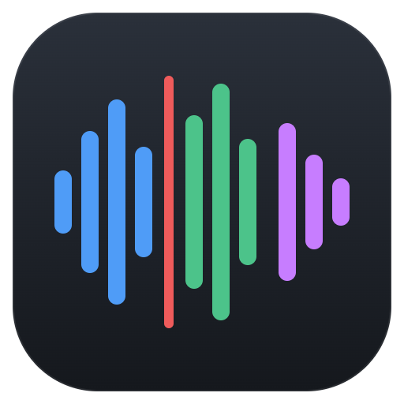
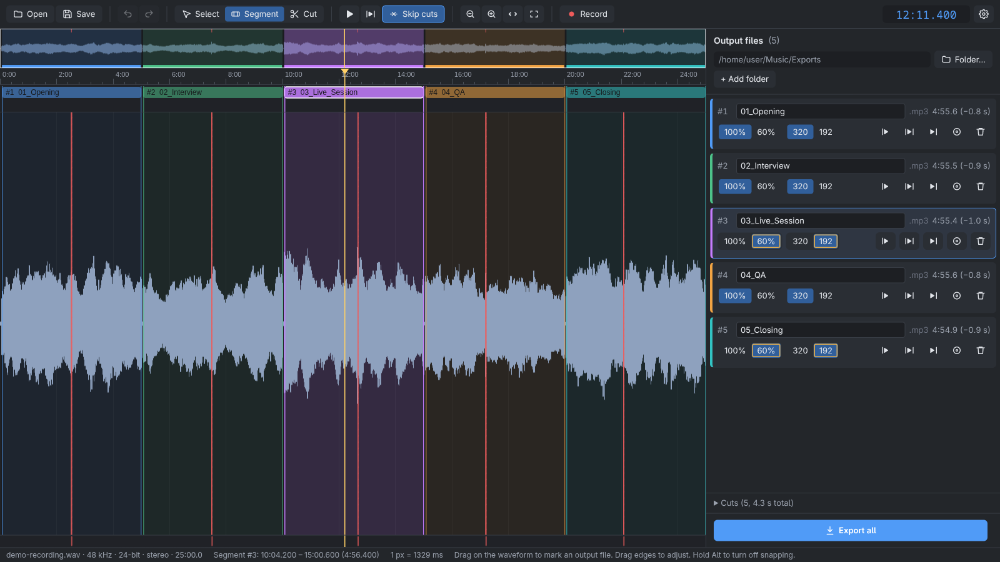
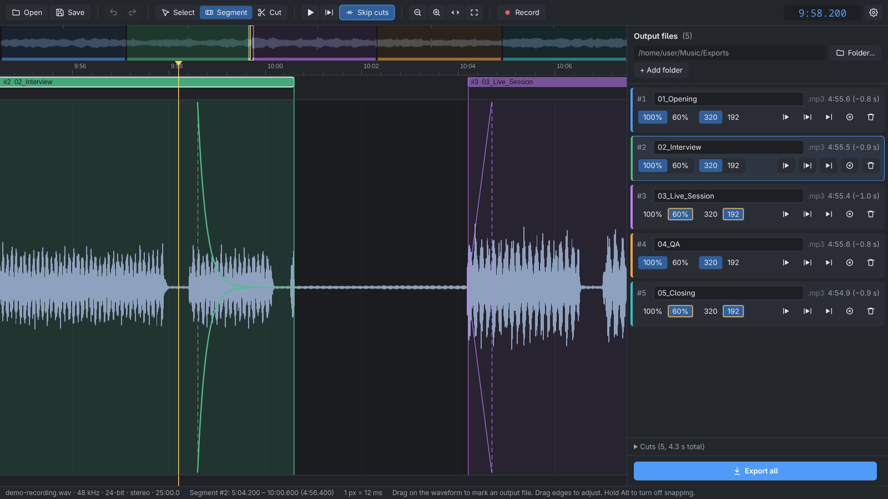
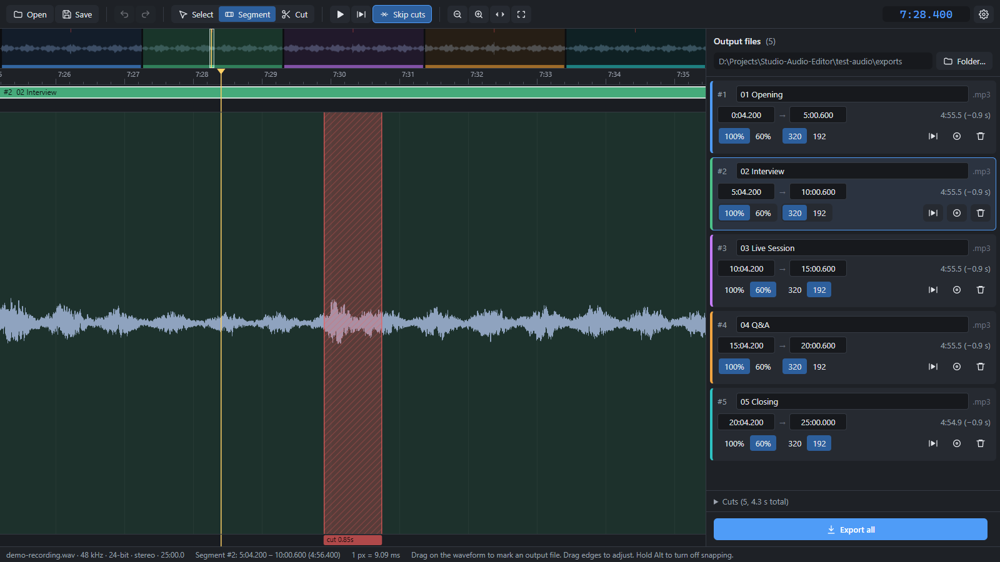
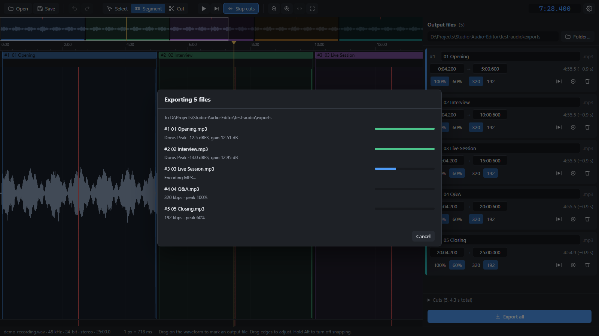
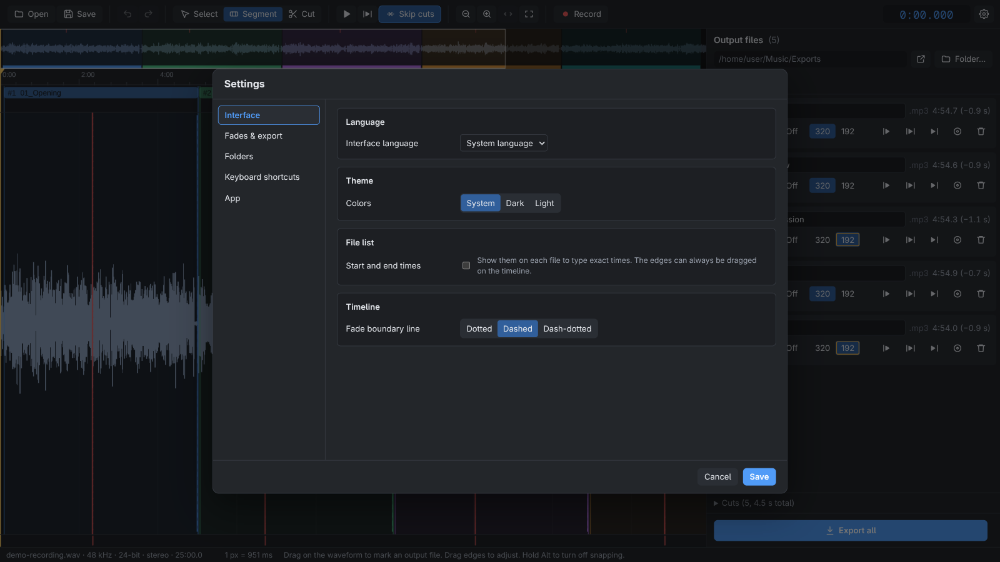
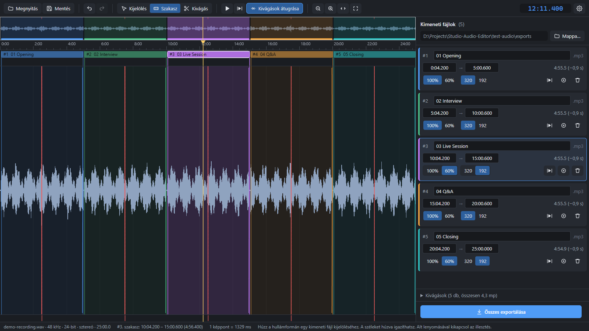
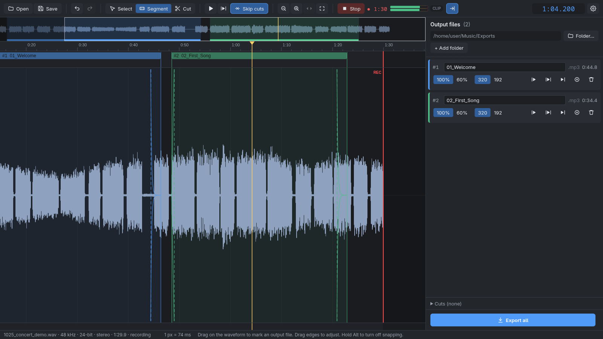

<h1> One Take</h1>

[](https://github.com/FeaXR/OneTake/actions/workflows/build.yml)
[](LICENSE)

A focused editor for cutting **one long WAV recording into several MP3 files**. It runs as a desktop app on Windows, macOS and Linux, and as a web app you host yourself with Docker, in two versions: one that works on files on the server, and one that runs entirely in the browser. It can also record that WAV itself, and you can start marking and exporting while the recording goes on.

Most audio editors work the other way round: many tracks in, one file out. One Take is for the opposite job: a long recording of a concert, a radio show or a lecture that has to become a set of separate, finished files. You mark where each file starts and ends, cut out coughs and noises, and export them all in one go. Each file gets consistent fades and its own loudness and bitrate.



## Features

- **One input, many outputs.** Mark any number of output files (segments) on a single WAV. Segments may slightly overlap.
- **Cuts.** Remove coughs, clicks or chatter. A cut applies to every segment it falls in, and the audio either side is joined with a short crossfade.
- **Consistent fades.** The same fade-in and fade-out on every file: linear in and exponential out by default, with other curves available.
- **Per-file peak normalization** to 100% or 60%, and **per-file bitrate** of 320 or 192 kbps (MP3, constant bitrate). Folders can have their own defaults, and any file can still differ.
- **Several output folders.** Files go to the session's default folder, or to any other folder you add for them.
- **Folder rules for names.** A rule can fill in the repetitive start of each filename: the next free number in the folder, the order within the recording, the date from the WAV's name, or a per-file type such as SH / HSZ. You type only the rest.
- **Record and edit at the same time.** Record from an audio interface (such as a Focusrite Scarlett) into a new 24-bit WAV, and mark, play and export finished pieces while the recording goes on.
- **Built for long files.** A 90-minute 24-bit recording opens in about 3 seconds and stays smooth while zooming and scrolling. The waveform overview is cached, so reopening is instant.
- **Mouse or keyboard.** Every action works with the mouse, and every action can also have a shortcut. Mark files with I/O and cuts with X while listening, and rebind any key in Settings.
- **Hear the result.** Playback skips the cuts by default, joining them with the same crossfade as the export, and inside the selected segment it plays that file's fade-in and fade-out too. Two buttons on each file play just its start or its end, to check the fades quickly.
- **Safe export.** Filenames are checked before anything is written, you're asked before files are overwritten, and a cancelled export never leaves half-written files.
- **Sessions are saved** in one place (Documents → One Take), so you can come back later and re-export.
- **Six interface languages:** English, German, French, Spanish, Hungarian and Serbian.

| Fades at a track boundary | A cut, ready to be removed |
| --- | --- |
|  |  |

| Exporting | Settings |
| --- | --- |
|  |  |

<details>
<summary>Hungarian interface</summary>



</details>

## Download

One Take comes in three forms. All of them have the same editor, the same export and the same recording.

| Version | Where the audio is | Best for |
| --- | --- | --- |
| [Desktop app](#desktop-app) | On your computer | Working on one computer, with no setup |
| [Server version](#server-version) (`ghcr.io/feaxr/onetake`) | In a folder on the server | Recordings that already live on a server or NAS, used from any browser |
| [Browser-only version](#browser-only-version) (`ghcr.io/feaxr/onetake-browser`) | On the computer the browser runs on | Using it from a browser without installing anything, while the audio never leaves your computer |

### Desktop app

Get the latest version from the [Releases page](https://github.com/FeaXR/OneTake/releases).

| System | File | Notes |
| --- | --- | --- |
| Windows | `One-Take-Setup-<version>.exe` | Installer with Start menu entry and uninstaller |
| Windows | `One-Take-<version>-portable.exe` | Single file, no installation. Starts a little slower because it unpacks itself each time. |
| macOS | `One-Take-<version>-mac-arm64.dmg` | For Macs with Apple silicon (M1 and later). Open it and drag One Take into Applications. |
| Linux | `One-Take-<version>-x86_64.AppImage` | Runs on most distributions. Make it executable first: `chmod +x One-Take-*.AppImage` |
| Linux | `one-take_<version>_amd64.deb` | For Debian, Ubuntu and derivatives |

The builds are not code-signed. On Windows, SmartScreen may show "Windows protected your PC" the first time; choose **More info → Run anyway**. On a Mac, the first start is refused with "One Take is damaged" or "cannot be verified". After dragging it into Applications, run this once in Terminal:

```bash
xattr -dr com.apple.quarantine "/Applications/One Take.app"
```

On a Mac, use **Cmd** wherever this page says Ctrl, and **Option** for Alt. Shortcuts are shown with the Mac symbols in the app.

#### Package managers

From version 1.6.2, One Take can also be installed with a package manager, which then also updates it.

**winget** (Windows), the same as the installer above:

```bash
winget install FeaXR.OneTake
```

**Scoop** (Windows), installed for your user only. Add this repository as a bucket once, then install:

```bash
scoop bucket add one-take https://github.com/FeaXR/OneTake
```

```bash
scoop install one-take/one-take
```

**AUR** (Arch Linux and derivatives such as CachyOS and Manjaro), as `one-take-bin`, with an AUR helper such as yay or paru:

```bash
yay -S one-take-bin
```

Copies from Scoop and the AUR don't update themselves: when a new version is out, the status bar says to update it with Scoop or the AUR. A copy from winget updates itself like the installer, and `winget upgrade` works too.

#### Updates

The app looks for a new version on GitHub when it starts (switch this off in **Settings → Updates**, where **Check now** also is). The Windows installer version and the AppImage download it in the background; the status bar then offers **restart to update**, and otherwise it is installed when you close the app. It never restarts during a recording or an export, and asks about unsaved changes first. The AppImage keeps its file name, so launchers made by AppImage managers keep working. The portable .exe, the .deb and the Mac version show a link to the download page instead, and copies from Scoop or the AUR say to update them there.

Builds of every commit are also available from the [Actions page](https://github.com/FeaXR/OneTake/actions/workflows/build.yml). Open a run and download the artifact at the bottom (requires a GitHub account).

## Using it

1. **Open a WAV file** (or [record one](#recording)). Use the Open button or Ctrl+O, or drag the file onto the window. You can also drop it onto the program's icon or shortcut (on a Mac, the Dock icon) to start the app with that file.
2. **Mark the output files (segments).**
   - Mouse: drag in the **top lane** above the waveform, or drag on the waveform with the **Segment** tool (active at startup).
   - Keyboard, while listening: press **I** at the start and **O** at the end.
3. **Name each file** in the list on the right, and choose **100% / 60%** and **320 / 192** for each one. Names have no spaces: while you type one, **Space** still plays and pauses, so you can name a file right after marking it and keep listening.
   - **Settings → Folder rules** can set the volume and bitrate for everything written to a folder (and its subfolders). Each file follows its folder unless you pick something else for it; overridden choices are outlined, and picking the folder's value again makes the file follow the folder.
   - With a naming rule for the output folder, the start of each name is filled in for you: `{nn}` is the next free number in the folder, `{n}` the order within the recording, `{date}` comes from the WAV name (`1018_….wav` → `261018`), and `{type}` is a per-file choice such as SH / HSZ. Rules also apply to subfolders. Click the generated part to change the type, for one file, it and the ones after it, or the whole folder.
4. **Mark cuts.**
   - Mouse: drag in the **bottom lane**, or use the **Cut** tool.
   - Keyboard: press **X** where the noise starts and **X** again where it ends.
5. **Export all** with Ctrl+E. Files go to the folder shown at the top of the list, which defaults to the WAV's folder. To send some files elsewhere, use **+ Add folder**: each file then gets a folder picker, and the first folder stays the default.

Your segments and cuts are saved in `Documents/One Take/Sessions`, one file per WAV (Ctrl+S). The session is tied to the WAV's location, so moving or renaming the WAV starts a new one. Sessions saved next to the WAV by older versions (`<file>.wav.sae.json`) still open. They're also saved after every successful export, and they load again when you reopen the WAV.

### Recording

Press **Record** in the toolbar (Ctrl+R) to record a new WAV instead of opening one.



- The dialog opens the input straight away, so you can check the level before starting. A Scarlett is chosen by default (afterwards, the input you used last). Inputs 1 and 2 are recorded as 24-bit stereo at the interface's sample rate; nothing is played back on the speakers while recording.
- Choose the folder and the file name. The name starts with today's date (`1025_…`), so folder rules can fill in `{date}`.
- While it records, the timeline grows to the red **live point**. Mark, cut and play as with any file: playback stops when it reaches the live point. The view follows the live point while it is on screen (toggle with **L** or the arrow button next to the meter).
- **Export all** writes the files whose end is already recorded; files that reach past the live point are marked *Still recording* and left for a later export.
- The meter shows both inputs; **CLIP** lights up when an input reaches full scale and stays lit until you click it.
- **Stop** asks first, then finishes the WAV. The computer is kept from going to sleep while recording, and the WAV's header is updated every second, so a crash or power cut loses at most the last second.

### Mouse

| Action | How |
| --- | --- |
| Move the playhead | Click the ruler or the waveform |
| Resize a segment or cut | Drag its edge (it snaps to the playhead and other edges; hold **Alt** to stop snapping) |
| Move a segment or cut | Drag its bar in the top or bottom lane |
| Zoom | Mouse wheel over the waveform or the overview |
| Scroll | Shift + wheel, middle-drag, drag the overview, or drag the waveform with the Select tool |
| More options | Right-click a segment, a cut, or empty space |
| Rename a segment | Double-click it |

### Keyboard

These are the defaults. You can change any of them in **Settings → Keyboard shortcuts**: click **+** next to a command and press the keys you want.

| Key | Action |
| --- | --- |
| Space | Play / pause |
| P | Play the selected segment, or the audio around the selected cut |
| Shift+P / Alt+P | Play the start (fade-in) or the end (fade-out) of the segment |
| I / O | Mark a segment's start / end at the playhead |
| Shift+I / Shift+O | Move the selected segment's start / end to the playhead |
| X | Mark a cut's start, then its end |
| Alt+← / Alt+→ | Nudge the selected start by 10 ms (add Shift to nudge the end) |
| ← / → | Playhead ±1 s (add Shift for ±10 s) |
| Ctrl+← / Ctrl+→ | Playhead to the previous / next segment or cut edge |
| Home / End | Playhead to the start / end of the file |
| Shift+Home / Shift+End | Playhead to the start / end of the selection |
| Ctrl+Home / Ctrl+End | Playhead to the start / end of the segment it's inside |
| C | Center the view on the playhead |
| Page Up / Page Down | Scroll one screen left / right |
| ↑ / ↓, Tab / Shift+Tab | Previous / next segment |
| + / − / F / Z | Zoom in / out / whole file / selection |
| 1 / 2 / 3 | Select / Segment / Cut tool |
| K | Skip cuts while playing (on by default) |
| Delete | Delete the selection |
| Ctrl+Z / Ctrl+Y | Undo / redo |
| Ctrl+S / Ctrl+E / Ctrl+O | Save / export / open |
| Ctrl+R | Record a new WAV |
| L | While recording: follow the live point or not |

## Settings

- **Language:** English, Deutsch (German), Español (Spanish), Français (French), Magyar (Hungarian) or Српски (Serbian, in Cyrillic). "System language" follows your operating system. Switching reloads the window; your open file and unsaved edits are kept, but undo history starts fresh.
- **Fade-in / fade-out:** length and curve. The defaults are 0.5 s linear in and 2 s exponential out.
- **"100%" peak level:** 0 dBFS by default. MP3 encoding can overshoot by a fraction of a dB, so −0.3 to −1 dBFS is safer if you want to avoid any clipping.
- **Crossfade at cuts:** 10 ms by default.
- **File list:** show each file's start and end time for typing exact times (hidden by default; the edges can always be dragged on the timeline).
- **Fade boundary line:** dotted, dashed or dash-dotted marker where a fade reaches full volume.
- **Folder rules:** for a folder and its subfolders, the start of filenames (`{nn}`, `{n}`, `{date}`, `{type}`), the `{type}` options, and default volume and bitrate. The deepest matching rule wins; a setting a rule leaves unset comes from a parent folder's rule.
- **Folder for each recording:** a rule can also name a folder made inside it for every recording, such as `{date}_{ampm}_{Venue}`. Parts: `{date}` (261030), `{year}`, `{yy}`, `{month}`, `{day}`, `{weekday}`, `{time}` (1905), `{hour}`, `{hour12}`, `{minute}`, and `{ampm}` with your own text for before and after noon. Any other name in braces, like `{Venue}`, is a field you fill in. When you open a WAV that has no session yet, One Take asks which rule folders its files go to. For each one you can make a new folder (the recording's start time comes from the file and can be corrected), reuse an earlier one, or put the files straight into the rule's folder. **No folder** keeps them next to the WAV. A new folder is created when the first file is exported into it.
- **Volume and bitrate presets:** the buttons each file offers. Volume is 1–100% or **Off** (no maximization: the level stays as recorded); bitrates are the ones an MP3 can have.
- **Files use:** the peak target and bitrate for files that no folder rule covers.
- **Updates:** look for a new version when the app starts, or check now (see [Updates](#updates)).

Settings are stored in `%APPDATA%\One Take` on Windows, `~/Library/Application Support/One Take` on macOS and `~/.config/One Take` on Linux. The server version keeps them in its `/config` folder, and the browser-only version in the browser's storage for the site. Versions from before the rename called the app Studio Audio Editor; its settings and sessions folders are moved to the new names on the first start.

## How export works

Each output file is rendered from the untouched WAV in two ffmpeg passes (ffmpeg reads the samples directly, without trusting the WAV header's length, so a file that is still being recorded exports the same way):

1. Trim the segment, remove the cuts, join the pieces with short crossfades and apply the fades. Then **measure the peak** of that finished audio.
2. Run the same chain again with the gain that brings the peak to its target, and encode to MP3.

Because the peak is measured after cuts and fades, a cut-out cough can't hold the level down. Files are written as `.part` first and renamed when complete.

## Web versions

Both web versions run in Docker and are used from a browser. Every release publishes both images to `ghcr.io`, tagged with the version and `latest`, for amd64 and arm64.

### Server version

`ghcr.io/feaxr/onetake` runs One Take on a server. The container holds the same editor, export and recording code as the desktop app, and works on files in a folder on the server. To keep the audio on your own computer instead, use the [browser-only version](#browser-only-version).

```bash
docker run -d --name one-take -p 8080:8080 -v ~/OneTake:/data -v one-take-config:/config -e ONETAKE_PASSWORD=choose-one ghcr.io/feaxr/onetake:latest
```

Then open `http://<server>:8080`. With Docker Compose (or **Install via YAML** on TrueNAS):

```yaml
services:
  one-take:
    image: ghcr.io/feaxr/onetake:latest
    restart: unless-stopped
    ports:
      - "8080:8080"
    environment:
      ONETAKE_PASSWORD: "choose-one"
    volumes:
      - ./OneTake:/data
      - ./one-take-config:/config
```

To build the image yourself instead: `docker build -t one-take .`

- **`/data`** holds the WAVs and the exported MP3s. **Open** and the folder buttons browse this folder on the server. **Upload WAV…** in the Open dialog, or dropping a WAV on the window, sends a file from your computer (dropped files go to `/data/Uploads`). **Show in folder** lists the folder with download links.
- **`/config`** holds settings, sessions and the waveform cache.
- The app runs as the image's `node` user (uid 1000). If the folder you mount belongs to someone else, add `--user $(id -u):$(id -g)`.

| Variable | Default | |
| --- | --- | --- |
| `ONETAKE_PASSWORD` | none | When set, the browser asks for it (any user name). Set it whenever the port can be reached by others. |
| `PORT` | `8080` | Port the server listens on |
| `ONETAKE_TLS_CERT`, `ONETAKE_TLS_KEY` | none | Paths to a certificate and key, to serve HTTPS directly instead of through a reverse proxy |
| `ONETAKE_DATA_DIR`, `ONETAKE_CONFIG_DIR` | `/data`, `/config` | The two folders above |

**Recording** works in the browser, from the audio inputs of the computer the browser runs on. Browsers allow this only on a secure page, so open the app over HTTPS (behind a reverse proxy such as Caddy or Traefik, or with the TLS variables), or as `http://localhost:8080` on the server itself. Samples are sent to the server as they arrive. A recording is finished properly when you stop it, close the tab, or stop the container.

The server is meant for one person at a time: like the desktop app, it has one open file, one recording and one export. Updates are not installed by the app. The status bar says when a new version is out, and you update by pulling the new image (or rebuilding it).

To run the server without Docker, use `npm run serve` (data in `./data`, unless `ONETAKE_DATA_DIR` says otherwise).

### Browser-only version

`ghcr.io/feaxr/onetake-browser` runs everything inside the browser. The container only serves the page. Opening a WAV, the waveform, playback, recording and the MP3 export all happen on the computer the browser runs on, and no audio, settings or sessions are sent to the server. The page's content security policy lets it contact nothing else except GitHub's release list for the update check, which can be switched off in Settings. After the first visit the page also opens without a connection to the server. Several people can use one container, each with their own files.

```bash
docker run -d --name one-take-browser -p 8080:8080 ghcr.io/feaxr/onetake-browser:latest
```

To build it yourself: `docker build --target browser -t one-take-browser .` It needs no volumes. `ONETAKE_PASSWORD`, `PORT` and the TLS variables work as in the table above.

Browsers keep files only for pages on a secure connection, so open it over HTTPS (behind a reverse proxy, or with the TLS variables), or as `http://localhost:8080` on the computer that runs the container. Where the files go depends on the browser:

- **Chrome and Edge** can use folders on the computer. **Add a folder from this computer…** in the Open and folder dialogs gives One Take a folder, such as the one your recordings are in. WAVs are opened where they are, and MP3s and recordings are written straight into it. After a browser restart, the browser asks once more before One Take may use it again.
- **Every browser** (Firefox, Safari, and Chromium-based browsers that switch folder access off, such as Brave) has the browser's own storage for this site, shown as the **One Take** folder. A WAV opened from elsewhere, or dropped on the window, is copied into `One Take/Imported` first. Exported MP3s and recordings stay there until you download them: **Show in folder** lists the files, and clicking one downloads it. The × next to a file deletes it.

A recording into a folder on the computer is written to the browser's storage while it runs, and copied into the folder when it stops. A recording that is cut off (by closing the tab, for example) stays in `One Take/Recordings in progress`.

The export gives the same audio as the desktop app's: the same trims, crossfades, fade curves and normalization, computed in the page (the tests compare it with ffmpeg's sample by sample), and encoded with the same LAME encoder, compiled to WebAssembly. A file that is cancelled or fails is never left half-written.

Run it without Docker with `npm run serve:browser`.

## Development

Requires Node.js 22 or newer.

```bash
npm install
npm run dev        # Vite dev server + Electron (UI hot-reloads)
npm test           # unit tests, and export tests against ffmpeg
npm run typecheck
npm run dist       # installers for the current OS, in release/
npm run icon       # re-render build/icon.png and build/icon.ico from build/icon.svg
```

`npm run dist` builds for the system it runs on: the installer and portable .exe on Windows, the .dmg on macOS, the AppImage and .deb on Linux.

### Automatic builds and releases

[GitHub Actions](.github/workflows/build.yml) builds and tests the app on Windows, macOS and Linux for every push and pull request. To publish a release, bump `version` in `package.json`, commit, then push a matching tag. The workflow attaches the five downloads to a new GitHub release, together with the `latest*.yml` and `.blockmap` files that installed copies use to update themselves, and pushes the Docker image to `ghcr.io`. A manual run of the workflow with **Publish the Docker image** ticked pushes the image alone:

```bash
git tag v1.0.0
```

```bash
git push origin v1.0.0
```

After the release, the workflow also writes the package-manager files with [scripts/package-manifests.mjs](scripts/package-manifests.mjs) and publishes them:

- **Scoop:** `bucket/one-take.json` is updated and committed to the default branch. This needs nothing set up.
- **AUR:** the `one-take-bin` package is pushed to the AUR, which creates it on the first push. This needs an [AUR account](https://aur.archlinux.org/register) with an SSH public key, and the matching private key as the repository secret `AUR_SSH_KEY`.
- **winget:** a pull request to [microsoft/winget-pkgs](https://github.com/microsoft/winget-pkgs) is opened from a fork under your account. It appears in winget once Microsoft's checks and a moderator approve it, usually within a few days. This needs a classic GitHub token with the `public_repo` scope as the repository secret `WINGET_TOKEN`.

Without its secret, the AUR or winget step is skipped.

Installed copies look for releases in the repository named under `build.publish` in `package.json`, so a fork that publishes its own releases only changes it there. If that repository is private, put a GitHub token that can read it in a file called `update-token` in the app's settings folder (`%APPDATA%\One Take` on Windows, `~/Library/Application Support/One Take` on macOS, `~/.config/One Take` on Linux) on each computer. The token is read when the app starts and is never built into the app.

### Project layout

- `src/main/`: Electron main process (WAV parsing, waveform scan and cache, ffmpeg export, reading samples for playback, writing recordings)
- `src/preload/`: the bridge between the UI and the main process (`window.studio`)
- `src/server/`, `src/web/`: the web build (Docker). The server does the main process's work over HTTP, and `src/web/` is the browser's `window.studio`, including the server file browser
- `src/browser/`: the browser-only build. Its `window.studio` keeps files in the browser's storage or in folders on the computer, settings and sessions in IndexedDB, and runs the waveform scan and the recording in web workers. `src/server/static.ts` serves it
- `src/shared/render.ts`, `src/shared/export.ts`: the export without ffmpeg (trim, crossfade, fades, gain, then LAME), used by the browser-only build
- `bucket/`: the Scoop manifest, written by the release workflow
- `scripts/package-manifests.mjs`: writes the AUR, Scoop and winget files for a release
- `src/renderer/`: the UI (canvas timeline and overview, output list, commands and shortcuts)
- `src/shared/`: types, time formatting, cut/segment planning and filename validation
- `src/shared/i18n/`: translations. `en.ts` is the master list of texts. To add a language, copy `hu.ts`, translate it, and register it in `index.ts`. The type checker reports any missing text, and a test checks that placeholders match.

### Contributing

Issues and pull requests are welcome. Please run `npm run typecheck` and `npm test` before opening a pull request. CI runs both on Windows and Linux.

## License

[MIT](LICENSE) © [Fixr](https://github.com/FeaXR)

The app bundles a static build of [FFmpeg](https://ffmpeg.org/) through [ffmpeg-static](https://github.com/eugeneware/ffmpeg-static). FFmpeg is licensed under the GPL v3, and its license and source reference ship with the app (`resources/app.asar.unpacked/node_modules/ffmpeg-static/`). It runs as a separate program, and the MIT license above covers only One Take's own code.
